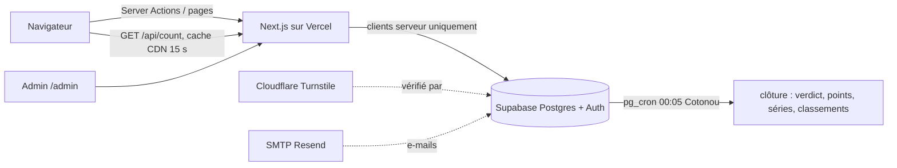

🇬🇧 [English](README.md) | 🇫🇷 Français

# Majorité

> Jeu quotidien à deux choix : on ne dit pas ce qu'on préfère, on parie sur ce que **la majorité** va choisir.


- Production : https://majorite.vercel.app
- Prototype d'origine (règles, textes, design) : [`majorite-reference.html`](majorite-reference.html)

## À propos

Chaque jour, Majorité pose une question à deux choix. On ne vote pas pour ce qu'on préfère : on parie sur le camp que la majorité des joueurs va choisir. Nouvelle question à minuit, heure de Cotonou (Africa/Porto-Novo, UTC+1). Juste après minuit, la base clôt la veille, calcule le verdict et met à jour points, séries et classements.

L'interface est en français, et les questions de lancement s'adressent à un public d'Afrique de l'Ouest (Bénin).

<!-- TODO: add screenshot -->

## Fonctionnalités

- **Un pari par jour**, pour aujourd'hui seulement. Le joueur démarre avec un compte anonyme et choisit un pseudo avant de parier.
- **Votes secrets** : personne ne voit la répartition A/B avant minuit. Seul le nombre total de paris est public (`/api/count`).
- **Verdict automatique** chaque nuit à 00:05 heure de Cotonou (pg_cron) : points, séries, égalités, jours sans question.
- **Classements de la semaine et général**, frise de progression et texte de partage.
- **Pages partageables** par jour (`/j/<n>`) avec images Open Graph générées.
- **Sauvegarde de la progression** : liaison du compte anonyme à Google ou à un e-mail (lien magique).
- **Back-office** (`/admin`) : calendrier des questions sur 30 jours, sponsors (« Présentée par … »), statistiques. Réservé à `ADMIN_EMAILS`.
- **PWA installable** (manifeste web et icônes).

## Stack technique

| Élément | Choix |
|---|---|
| Front + serveur | Next.js 16 (App Router, Cache Components), React 19, TypeScript, Tailwind CSS 4 (sans reset : le CSS du prototype est repris tel quel) |
| Base, auth, tâches planifiées | Supabase : Postgres 17, Auth (comptes anonymes, Google, lien magique), RLS, pg_cron |
| Anti-robots | Cloudflare Turnstile, vérifié par Supabase Auth |
| E-mails | SMTP Resend branché dans Supabase |
| Statistiques de visite | Microsoft Clarity (optionnel, chargé quand le navigateur est inactif) |
| Hébergement | Vercel, fonctions en région Paris (`cdg1`), base en `eu-west-3` (Paris) |
| Tests | Vitest (logique de jeu), pgTAP (règles en base) |
| Gestionnaire de paquets | pnpm 10 |

## Choix techniques notables

- **Le jour se calcule toujours sur le serveur** : `public.game_today()` en SQL, `lib/game/day.ts` côté Next. Le navigateur ne fait qu'afficher un compte à rebours vers une échéance donnée par le serveur.
- **Le navigateur ne parle jamais à Supabase.** Toutes les opérations passent par des Server Actions (`app/actions.ts`). Il n'y a pas de supabase-js côté client, ce qui garde la page légère, et aucune variable d'environnement n'a de préfixe `NEXT_PUBLIC_`.
- **Les données publiques sont en cache par jour** (`lib/data.ts`, `"use cache"`) : question, verdict, classements. Un pic de trafic ne touche pas la base. Le compteur de paris en direct (`/api/count`) est mis en cache 15 s par le CDN.
- **Les règles sont garanties par la base**, pas par l'interface : RLS, fonctions `security definer` et limites de fréquence (voir [Sécurité](#sécurité--ce-qui-garantit-les-règles)).
- **Le verdict est idempotent** : relancé, il ne compte rien deux fois, et un recalcul complet donne les mêmes scores que le calcul jour par jour.

## Architecture



## Démarrage

### Prérequis

- Node.js 22+
- pnpm 10
- Docker (pour Supabase en local)

### Installation

```bash
pnpm install
```

```bash
npx supabase start
```

`supabase start` applique les migrations et affiche l'URL et les clés locales (`API URL`, `Publishable key`, `Secret key`).

### Configuration

```bash
cp .env.example .env.local
```

Remplis `.env.local` avec les valeurs locales. Pour jouer tout de suite, mets `LAUNCH_DATE` à la date du jour. Laisse `TURNSTILE_SITE_KEY` vide : la captcha est désactivée en local.

Toutes les variables sont lues **uniquement côté serveur**. Aucune n'a de préfixe `NEXT_PUBLIC_`. Modèle : [`.env.example`](.env.example).

| Variable | Obligatoire | Rôle |
|---|---|---|
| `SITE_URL` | oui | Adresse publique, sans `/` final. Sert aux liens de partage et aux retours de connexion. |
| `LAUNCH_DATE` | oui | Jour n° 1 (`AAAA-MM-JJ`). **Ne plus la changer après le lancement** : les numéros et les liens `/j/<n>` en dépendent. |
| `SUPABASE_URL` | oui | URL du projet Supabase. |
| `SUPABASE_PUBLISHABLE_KEY` | oui | Clé publishable (`sb_publishable_…`). |
| `SUPABASE_SECRET_KEY` | oui | Clé secrète (`sb_secret_…`). Serveur seulement : admin, script d'import, et transfert de l'IP du joueur vers Supabase Auth. |
| `ADMIN_EMAILS` | oui | E-mails autorisés sur `/admin`, séparés par des virgules. |
| `TURNSTILE_SITE_KEY` | en production | Clé de site Turnstile. La clé secrète va dans Supabase, pas ici. |
| `CLARITY_PROJECT_ID` | non | Identifiant Microsoft Clarity. |

Une variable obligatoire manquante fait échouer la requête avec son nom dans l'erreur : le site ne tourne jamais à moitié configuré. Les options désactivées (Turnstile, Clarity) sont signalées en haut de `/admin`.

### Importer les questions et lancer

```bash
LAUNCH_DATE=$(TZ=Africa/Porto-Novo date +%F) pnpm seed:questions
```

```bash
pnpm dev
```

Le site tourne sur http://127.0.0.1:3000. Les e-mails envoyés en local arrivent dans Mailpit : http://127.0.0.1:54324.

### Scripts disponibles

| Commande | Rôle |
|---|---|
| `pnpm dev` | Serveur de développement Next.js |
| `pnpm build` / `pnpm start` | Build de production / exécution |
| `pnpm lint` | ESLint |
| `pnpm typecheck` | `tsc --noEmit` |
| `pnpm test` | Tests unitaires Vitest |
| `pnpm test:db` | Tests pgTAP de la base (`supabase test db`) |
| `pnpm seed:questions` | Import des questions de lancement (`--sql` affiche le SQL à la place) |

## Utilisation

### Ajouter des questions

**Au quotidien : `/admin`.**

1. Connecte-toi sur `SITE_URL/admin` (Google ou lien magique) avec un e-mail de `ADMIN_EMAILS`.
2. Le calendrier montre les 30 prochains jours. Une alerte liste les jours sans question.
3. Ouvre un jour, remplis les deux choix et, si besoin, le sponsor (nom, lien `https://…`, logo `https://…`). Enregistre.
   - Avec un sponsor, la question affiche « Présentée par … ». Sans sponsor, le bloc « Espace annonceur » apparaît.
   - Un jour passé ne peut plus être modifié : c'est la base qui le refuse.

**En lot : le script d'import.** Il ne remplace jamais un jour déjà rempli.

```bash
LAUNCH_DATE=2026-11-02 pnpm seed:questions
```

Pour obtenir le SQL à coller dans l'éditeur SQL de Supabase :

```bash
LAUNCH_DATE=2026-11-02 pnpm seed:questions --sql
```

Pour une autre liste, modifie `lib/game/questions.ts`. Les questions démarrent à `LAUNCH_DATE`, une par jour.

Les 45 questions du prototype couvrent du 2 novembre (#1) au 16 décembre 2026 (#45). Pense à compléter le calendrier avant.

## Déploiement

### Projet Supabase

1. **Projet** : crée un projet (région conseillée : `eu-west-3` Paris). Applique les migrations :

   ```bash
   npx supabase link --project-ref <ref>
   ```

   ```bash
   npx supabase db push
   ```

2. **Authentication → Sign In / Providers**
   - Active « Allow anonymous sign-ins » et « Allow manual linking ».
   - Active **Google** avec l'ID client et le secret créés dans Google Cloud Console → Clients → Application Web.
     - URI de redirection autorisé : `https://<ref>.supabase.co/auth/v1/callback`
     - Origine JavaScript autorisée : `SITE_URL`
     - Publie l'application (statut « En production »), sinon seuls les comptes de test peuvent se connecter.
3. **Authentication → URL Configuration**
   - Site URL : `SITE_URL`
   - Redirect URLs : `SITE_URL/**` et `http://localhost:3000/**`
4. **Authentication → Rate Limits** : active **IP Address Forwarding**. Sans ça, tous les joueurs partagent l'IP de Vercel, et la limite de 30 comptes anonymes par heure et par IP bloque le jeu.
5. **Authentication → Attack Protection** : active la captcha, fournisseur Turnstile, avec la **Secret Key**. Fais-le seulement quand `TURNSTILE_SITE_KEY` est en ligne, sinon plus aucun compte ne peut être créé.
6. **Authentication → Emails → SMTP Settings** : configure Resend.
   - Hôte `smtp.resend.com`, port `465`, utilisateur `resend`, mot de passe = la clé API Resend.
   - Expéditeur : une adresse du domaine vérifié dans Resend.
7. **Authentication → Emails → Templates** (modifiable seulement avec un SMTP personnalisé) : colle les contenus de `supabase/templates/magic_link.html` (« Magic Link ») et `supabase/templates/email_change.html` (« Change Email Address »). Le site accepte aussi les modèles par défaut, mais les modèles fournis fonctionnent même si le lien est ouvert dans un autre navigateur.
8. **Questions** : importe les questions de lancement (voir [Ajouter des questions](#ajouter-des-questions)).

### Vercel

1. Importe le dépôt dans Vercel (framework Next.js, commande d'installation `pnpm install`). Dans Settings → Functions, règle la région sur `cdg1`.
2. Settings → Environment Variables : ajoute les variables du tableau ci-dessus. Mets `SUPABASE_SECRET_KEY` en type « Sensitive ».
3. Settings → Deployment Protection : limite « Vercel Authentication » aux **Preview** seulement. Sinon le site public n'est visible que par l'équipe.
4. Déploie. Chaque changement de variable demande un nouveau déploiement.
5. Dans Cloudflare Turnstile, ajoute le domaine du site (et `localhost`) dans les Hostnames du widget.

La branche de production est `claude/majorite-daily-game-ymz0j5`.

## Structure du projet

```
app/
  page.tsx                 page du jour (serveur) → _components/play.tsx (îlot client)
  actions.ts               Server Actions joueur : compte anonyme, pari, pseudo, liaison Google / e-mail
  j/[numero]/              page partageable d'un jour + image Open Graph
  opengraph-image.tsx      image OG de la question du jour
  admin/                   calendrier, sponsors, stats (accès ADMIN_EMAILS)
  auth/callback, confirm   retours de Google et des liens e-mail
  api/count                nombre de paris du jour (jamais la répartition)
  manifest.ts              manifeste PWA
lib/
  game/day.ts              jours de Cotonou, numéro du jour, semaines
  game/scoring.ts          points, séries, égalités, frise, texte de partage
  game/questions.ts        les 45 questions de lancement
  data.ts                  lectures publiques en cache
  me.ts                    état du joueur connecté (RPC my_state)
  env.ts                   variables d'environnement côté serveur
  supabase/                clients serveur (joueur, connexion, public, admin)
proxy.ts                   rafraîchit la session Supabase (ex-middleware)
supabase/
  migrations/              schéma, fonctions, RLS, cron, stats admin
  tests/                   tests pgTAP
  templates/               modèles d'e-mail (lien magique, changement d'e-mail)
scripts/seed-questions.ts  import des questions de lancement
tests/                     tests Vitest
.github/workflows/         sauvegarde hebdomadaire de la base
```

## Tests

```bash
pnpm test
```

Vitest : changement de jour à minuit à Cotonou (et non en UTC), mois, années bissextiles, numéros de jour, semaines du lundi au dimanche, points, séries, égalités, jours sans question, frise et texte de partage.

```bash
pnpm test:db
```

pgTAP, sur la base locale démarrée par `supabase start`. Ces tests prouvent qu'un joueur :

- ne peut pas lire les votes des autres, ni ceux du jour ;
- ne peut pas voter deux fois, même pour le même camp ;
- ne peut pas voter pour un jour passé (aucune écriture directe, et `cast_vote` n'accepte pas de date) ;
- ne peut pas voter sans pseudo, ni un jour sans question ;
- est limité en fréquence sur `cast_vote` et `set_pseudo` ;
- ne voit pas les questions futures ;
- ne peut écrire ni verdicts, ni scores, ni profils, ni lancer le calcul de minuit.

Ils prouvent aussi que le verdict est **idempotent** : relancé, il ne compte rien deux fois, et un recalcul complet donne les mêmes scores que le calcul jour par jour. Ils vérifient enfin le filtre de pseudos, les classements et l'heure du cron.

```bash
pnpm lint
```

```bash
pnpm typecheck
```

## Exploitation

**Tâches planifiées (pg_cron, heures UTC) :**

| Tâche | Horaire | Rôle |
|---|---|---|
| `majorite-finalize` | `5 23 * * *` (00:05 Cotonou) | Clôt la veille : verdict, points, séries, classement de la semaine |
| `majorite-finalize-catchup` | `35 * * * *` | Filet de sécurité : rattrape un jour non clos (ne fait rien sinon) |
| `majorite-cleanup` | `17 3 * * *` | Purge les limites de fréquence, et les comptes anonymes de plus de 30 jours sans pseudo |

Pour voir les dernières exécutions, dans l'éditeur SQL :

```sql
select * from cron.job_run_details order by start_time desc limit 20;
```

**Réparer les scores** : `select private.rebuild_player_stats();` (en SQL, en tant que postgres). Recalcule tout à partir des verdicts.

**Sauvegarde** : `.github/workflows/backup.yml` exporte la base chaque lundi. Le plan gratuit de Supabase n'en fait pas.

- Le secret de dépôt `SUPABASE_DB_URL` est nécessaire : Supabase → Connect → chaîne « Session pooler », avec le mot de passe de la base.
- Les fichiers sont gardés 90 jours (Actions → Backup → Artifacts).

Pour restaurer une sauvegarde :

```bash
pg_restore --no-owner -d "<url>" majorite-AAAA-MM-JJ.dump
```

**Limites gratuites à surveiller :**

- Supabase : 500 Mo de base, 50 000 utilisateurs actifs par mois (les anonymes comptent), projet mis en pause après 7 jours sans activité.
- Resend : 100 e-mails par jour.
- Vercel Hobby : usage non commercial.

## Sécurité : ce qui garantit les règles

- **Votes secrets** : RLS sur `votes`, chaque joueur ne lit que ses propres lignes. Aucune policy d'écriture. `today_count()` ne renvoie qu'un nombre. La répartition A/B n'existe que dans `daily_results`, écrite à minuit pour la veille.
- **Un pari par jour, pour aujourd'hui seulement** : clé primaire `(user_id, day)`. `cast_vote(choice)` est `security definer` et calcule lui-même le jour. Il vérifie la question, le pseudo et la limite de fréquence (10 par minute). Les refus sont renvoyés comme codes d'erreur, pour que la limite compte aussi les tentatives refusées.
- **Questions futures invisibles** : la policy `day <= game_today()`.
- **Admin** : vérifié côté serveur à chaque requête (`getUser()`). Il faut un compte non anonyme, avec un e-mail confirmé présent dans `ADMIN_EMAILS`. Sinon, la page renvoie une 404. Les écritures admin utilisent la clé secrète, uniquement après cette vérification.
- **Faux comptes** : Turnstile (vérifié par Supabase) et la limite par IP réelle du joueur (`sb-forwarded-for`).
- **Pseudos** : de 3 à 20 caractères, uniques sans tenir compte des majuscules. Le filtre d'insultes (table `banned_words`) neutralise accents, leetspeak et lettres répétées.
- **Secrets** : aucun dans le code. Les fichiers `.env*` sont ignorés par git (sauf `.env.example`), et la clé secrète n'est que dans Vercel.

## Auteur

[andysags](https://github.com/andysags)

## Licence

Aucun fichier de licence n'est inclus dans ce dépôt.

Les fichiers de police dans `assets/fonts` (Unbounded, Instrument Sans) sont sous licence SIL Open Font License 1.1 ([`assets/fonts/LICENSE.txt`](assets/fonts/LICENSE.txt)). Ils servent seulement aux images Open Graph.
