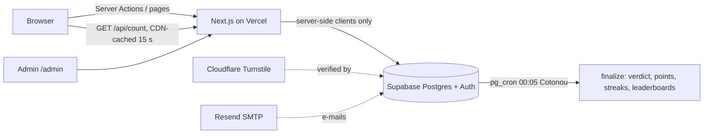

🇬🇧 English | 🇫🇷 [Français](README.fr.md)

# Majorité

> A daily two-choice game: you don't pick what you prefer, you bet on what **the majority** will pick.


- Production: https://majorite.vercel.app
- Original prototype (rules, copy, design): [`majorite-reference.html`](majorite-reference.html)

## About

Every day, Majorité asks one question with two options. Players don't vote for their own preference: they bet on which side most players will choose. A new question goes live at midnight, Cotonou time (Africa/Porto-Novo, UTC+1). Just after midnight, the database closes the previous day, computes the verdict, and updates points, streaks and leaderboards.

The UI is in French and the launch questions are written for a West African (Beninese) audience.

<!-- TODO: add screenshot -->

## Key features

- **One bet per day**, for today only. Players start with an anonymous account and pick a pseudo before betting.
- **Hidden votes**: nobody can see the A/B split before midnight. Only the total number of bets is public (`/api/count`).
- **Automatic nightly verdict** at 00:05 Cotonou time (pg_cron), with points, streaks, ties and days without a question.
- **Weekly and global leaderboards**, plus a progress strip and share text.
- **Shareable day pages** (`/j/<n>`) with generated Open Graph images.
- **Save your progress**: link the anonymous account to Google or to an e-mail (magic link).
- **Admin back office** (`/admin`): 30-day question calendar, sponsors ("Présentée par …"), stats. Restricted to `ADMIN_EMAILS`.
- **Installable PWA** (web manifest and icons).

## Tech stack

| Area | Choice |
|---|---|
| Front end + server | Next.js 16 (App Router, Cache Components), React 19, TypeScript, Tailwind CSS 4 (no reset: the prototype's CSS is reused as is) |
| Database, auth, scheduled jobs | Supabase: Postgres 17, Auth (anonymous accounts, Google, magic link), RLS, pg_cron |
| Bot protection | Cloudflare Turnstile, verified by Supabase Auth |
| E-mail | Resend SMTP, configured in Supabase |
| Visit analytics | Microsoft Clarity (optional, loaded when the browser is idle) |
| Hosting | Vercel, functions in the Paris region (`cdg1`), database in `eu-west-3` (Paris) |
| Tests | Vitest (game logic), pgTAP (database rules) |
| Package manager | pnpm 10 |

## Notable technical choices

- **The day is always computed on the server**: `public.game_today()` in SQL, `lib/game/day.ts` in Next.js. The browser only displays a countdown to a deadline given by the server.
- **The browser never talks to Supabase.** Every operation goes through Server Actions (`app/actions.ts`). There is no supabase-js on the client, which keeps the page light, and no environment variable has a `NEXT_PUBLIC_` prefix.
- **Public data is cached per day** (`lib/data.ts`, `"use cache"`): question, verdict, leaderboards. A traffic spike does not reach the database. The live bet counter (`/api/count`) is cached 15 s by the CDN.
- **The rules are enforced by the database**, not the UI: RLS, `security definer` functions and rate limits (see [Security](#security-what-enforces-the-rules)).
- **The verdict is idempotent**: re-running it never counts anything twice, and a full rebuild gives the same scores as day-by-day computation.

## Architecture



## Getting started

### Prerequisites

- Node.js 22+
- pnpm 10
- Docker (for local Supabase)

### Install

```bash
pnpm install
```

```bash
npx supabase start
```

`supabase start` applies the migrations and prints the local URL and keys (`API URL`, `Publishable key`, `Secret key`).

### Configuration

```bash
cp .env.example .env.local
```

Fill `.env.local` with the local values. To play right away, set `LAUNCH_DATE` to today's date. Leave `TURNSTILE_SITE_KEY` empty: CAPTCHA is disabled locally.

All variables are read **server-side only**. None has a `NEXT_PUBLIC_` prefix. Template: [`.env.example`](.env.example).

| Variable | Required | Purpose |
|---|---|---|
| `SITE_URL` | yes | Public URL, no trailing `/`. Used for share links and sign-in redirects. |
| `LAUNCH_DATE` | yes | Day #1 (`YYYY-MM-DD`). **Never change it after launch**: day numbers and `/j/<n>` links depend on it. |
| `SUPABASE_URL` | yes | Supabase project URL. |
| `SUPABASE_PUBLISHABLE_KEY` | yes | Publishable key (`sb_publishable_…`). |
| `SUPABASE_SECRET_KEY` | yes | Secret key (`sb_secret_…`). Server only: admin, seed script, and forwarding the player's IP to Supabase Auth. |
| `ADMIN_EMAILS` | yes | E-mails allowed on `/admin`, comma-separated. |
| `TURNSTILE_SITE_KEY` | in production | Turnstile site key. The secret key goes in Supabase, not here. |
| `CLARITY_PROJECT_ID` | no | Microsoft Clarity project ID. |

A missing required variable makes the request fail with its name in the error, so the site never runs half-configured. Disabled options (Turnstile, Clarity) are flagged at the top of `/admin`.

### Seed questions and run

```bash
LAUNCH_DATE=$(TZ=Africa/Porto-Novo date +%F) pnpm seed:questions
```

```bash
pnpm dev
```

The site runs at http://127.0.0.1:3000. E-mails sent locally land in Mailpit: http://127.0.0.1:54324.

### Available scripts

| Command | What it does |
|---|---|
| `pnpm dev` | Start the Next.js dev server |
| `pnpm build` / `pnpm start` | Production build / serve |
| `pnpm lint` | ESLint |
| `pnpm typecheck` | `tsc --noEmit` |
| `pnpm test` | Vitest unit tests |
| `pnpm test:db` | pgTAP database tests (`supabase test db`) |
| `pnpm seed:questions` | Import the launch questions (`--sql` prints SQL instead) |

## Usage

### Adding questions

**Day to day: `/admin`.**

1. Sign in at `SITE_URL/admin` (Google or magic link) with an e-mail listed in `ADMIN_EMAILS`.
2. The calendar shows the next 30 days. An alert lists the days without a question.
3. Open a day, fill in both options and, optionally, the sponsor (name, `https://…` link, `https://…` logo). Save.
   - With a sponsor, the question shows "Présentée par …". Without one, the "Espace annonceur" block appears.
   - A past day can no longer be edited: the database refuses it.

**In bulk: the seed script.** It never overwrites a day that already has a question.

```bash
LAUNCH_DATE=2026-11-02 pnpm seed:questions
```

To get the SQL to paste into the Supabase SQL editor:

```bash
LAUNCH_DATE=2026-11-02 pnpm seed:questions --sql
```

To use another list, edit `lib/game/questions.ts`. Questions start at `LAUNCH_DATE`, one per day.

The 45 prototype questions cover November 2 (#1) to December 16, 2026 (#45). Fill the calendar before then.

## Deployment

### Supabase project

1. **Project**: create a project (suggested region: `eu-west-3` Paris). Apply the migrations:

   ```bash
   npx supabase link --project-ref <ref>
   ```

   ```bash
   npx supabase db push
   ```

2. **Authentication → Sign In / Providers**
   - Enable "Allow anonymous sign-ins" and "Allow manual linking".
   - Enable **Google** with the client ID and secret created in Google Cloud Console → Clients → Web application.
     - Authorized redirect URI: `https://<ref>.supabase.co/auth/v1/callback`
     - Authorized JavaScript origin: `SITE_URL`
     - Publish the app ("In production" status), otherwise only test accounts can sign in.
3. **Authentication → URL Configuration**
   - Site URL: `SITE_URL`
   - Redirect URLs: `SITE_URL/**` and `http://localhost:3000/**`
4. **Authentication → Rate Limits**: enable **IP Address Forwarding**. Without it, every player shares Vercel's IP, and the limit of 30 anonymous accounts per hour per IP blocks the game.
5. **Authentication → Attack Protection**: enable CAPTCHA, provider Turnstile, with the **Secret Key**. Only do this once `TURNSTILE_SITE_KEY` is live, otherwise no account can be created anymore.
6. **Authentication → Emails → SMTP Settings**: configure Resend.
   - Host `smtp.resend.com`, port `465`, user `resend`, password = the Resend API key.
   - Sender: an address on the domain verified in Resend.
7. **Authentication → Emails → Templates** (editable only with custom SMTP): paste `supabase/templates/magic_link.html` ("Magic Link") and `supabase/templates/email_change.html` ("Change Email Address"). The site also accepts the default templates, but the provided ones work even when the link is opened in another browser.
8. **Questions**: import the launch questions (see [Adding questions](#adding-questions)).

### Vercel

1. Import the repository into Vercel (Next.js framework, install command `pnpm install`). In Settings → Functions, set the region to `cdg1`.
2. Settings → Environment Variables: add the variables from the table above. Set `SUPABASE_SECRET_KEY` as "Sensitive".
3. Settings → Deployment Protection: restrict "Vercel Authentication" to **Preview** only. Otherwise the public site is only visible to the team.
4. Deploy. Every variable change requires a new deployment.
5. In Cloudflare Turnstile, add the site's domain (and `localhost`) to the widget's Hostnames.

The production branch is `claude/majorite-daily-game-ymz0j5`.

## Project structure

```
app/
  page.tsx                 today's page (server) → _components/play.tsx (client island)
  actions.ts               player Server Actions: anonymous account, bet, pseudo, Google / e-mail linking
  j/[numero]/              shareable day page + Open Graph image
  opengraph-image.tsx      OG image for today's question
  admin/                   calendar, sponsors, stats (ADMIN_EMAILS only)
  auth/callback, confirm   returns from Google and e-mail links
  api/count                number of bets today (never the split)
  manifest.ts              PWA manifest
lib/
  game/day.ts              Cotonou days, day number, weeks
  game/scoring.ts          points, streaks, ties, progress strip, share text
  game/questions.ts        the 45 launch questions
  data.ts                  cached public reads
  me.ts                    signed-in player state (my_state RPC)
  env.ts                   server-side environment variables
  supabase/                server clients (player, sign-in, public, admin)
proxy.ts                   refreshes the Supabase session (formerly middleware)
supabase/
  migrations/              schema, functions, RLS, cron, admin stats
  tests/                   pgTAP tests
  templates/               e-mail templates (magic link, e-mail change)
scripts/seed-questions.ts  launch question import
tests/                     Vitest tests
.github/workflows/         weekly database backup
```

## Tests

```bash
pnpm test
```

Vitest: day change at midnight in Cotonou (not UTC), months, leap years, day numbers, Monday-to-Sunday weeks, points, streaks, ties, days without a question, progress strip and share text.

```bash
pnpm test:db
```

pgTAP, against the local database started by `supabase start`. These tests prove that a player:

- cannot read other players' votes, nor today's votes;
- cannot vote twice, even for the same side;
- cannot vote for a past day (no direct writes, and `cast_vote` takes no date);
- cannot vote without a pseudo, or on a day without a question;
- is rate-limited on `cast_vote` and `set_pseudo`;
- cannot see future questions;
- cannot write verdicts, scores or profiles, nor trigger the midnight computation.

They also prove the verdict is **idempotent**: re-running it counts nothing twice, and a full rebuild gives the same scores as day-by-day computation. Finally they check the pseudo filter, leaderboards and the cron schedule.

```bash
pnpm lint
```

```bash
pnpm typecheck
```

## Operations

**Scheduled jobs (pg_cron, UTC times):**

| Job | Schedule | Purpose |
|---|---|---|
| `majorite-finalize` | `5 23 * * *` (00:05 Cotonou) | Closes the previous day: verdict, points, streaks, weekly leaderboard |
| `majorite-finalize-catchup` | `35 * * * *` | Safety net: catches up a day that wasn't closed (no-op otherwise) |
| `majorite-cleanup` | `17 3 * * *` | Purges rate limits, and anonymous accounts older than 30 days without a pseudo |

To see recent runs, in the SQL editor:

```sql
select * from cron.job_run_details order by start_time desc limit 20;
```

**Repair scores**: `select private.rebuild_player_stats();` (in SQL, as postgres). Recomputes everything from the verdicts.

**Backup**: `.github/workflows/backup.yml` dumps the database every Monday. The Supabase free plan has no backups.

- The repository secret `SUPABASE_DB_URL` is required: Supabase → Connect → "Session pooler" connection string, with the database password.
- Dumps are kept 90 days (Actions → Backup → Artifacts).

To restore a backup:

```bash
pg_restore --no-owner -d "<url>" majorite-YYYY-MM-DD.dump
```

**Free-tier limits to watch:**

- Supabase: 500 MB database, 50,000 monthly active users (anonymous users count), project paused after 7 days of inactivity.
- Resend: 100 e-mails per day.
- Vercel Hobby: non-commercial use.

## Security: what enforces the rules

- **Secret votes**: RLS on `votes`, each player only reads their own rows. No write policy. `today_count()` only returns a number. The A/B split only exists in `daily_results`, written at midnight for the previous day.
- **One bet per day, for today only**: primary key `(user_id, day)`. `cast_vote(choice)` is `security definer` and computes the day itself. It checks the question, the pseudo and the rate limit (10 per minute). Refusals are returned as error codes, so the limit also counts refused attempts.
- **Future questions are invisible**: policy `day <= game_today()`.
- **Admin**: checked server-side on every request (`getUser()`). It requires a non-anonymous account with a confirmed e-mail listed in `ADMIN_EMAILS`. Otherwise the page returns a 404. Admin writes use the secret key, only after this check.
- **Fake accounts**: Turnstile (verified by Supabase) and the per-IP limit on the player's real IP (`sb-forwarded-for`).
- **Pseudos**: 3 to 20 characters, case-insensitively unique. The profanity filter (`banned_words` table) neutralizes accents, leetspeak and repeated letters.
- **Secrets**: none in the code. `.env*` files are git-ignored (except `.env.example`), and the secret key only lives in Vercel.

## Author

[andysags](https://github.com/andysags)

## License

No license file is included in this repository.

The font files in `assets/fonts` (Unbounded, Instrument Sans) are under the SIL Open Font License 1.1 ([`assets/fonts/LICENSE.txt`](assets/fonts/LICENSE.txt)). They are only used for Open Graph images.
